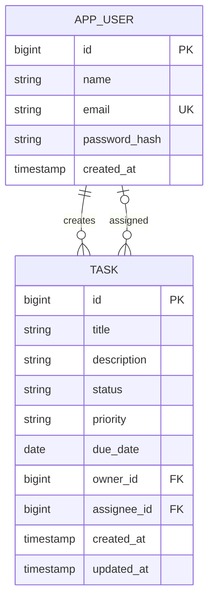

# TaskFlow — Task Management Tool

A college full-stack project built with Java 17, Spring Boot, Spring Security, JWT, Spring Data JPA, and MySQL. The responsive browser interface is served by Spring Boot and uses the authenticated REST API.

## Features

- Account registration and login with BCrypt password hashing
- JWT bearer authentication for protected API routes
- Create, view, update, and delete tasks
- Filter tasks by status, priority, and due-date range
- Assign a task to another registered user; assignees can view it and update its status
- Ownership checks: only the task creator can edit task details, assign, unassign, or delete
- Due date validation and consistent JSON error responses
- MySQL database, Docker Compose setup, and Swagger UI
- Responsive dashboard with sign-in/register, task cards, summary counts, and task editor

## Requirements

- Java 17+
- Maven 3.9+ (or Docker Desktop)
- MySQL 8+ if running without Docker

## Run with Docker

From this directory, run:

```bash
docker compose up --build
```

The app will be available at `http://localhost:8080`. Swagger API documentation is at `http://localhost:8080/swagger-ui/index.html`.

The compose file uses development-only database passwords and a development JWT secret. Do not use those values outside a local demo. Override them with strong secrets before deploying anywhere.

## Run locally

1. Start MySQL and create the local database and account. In MySQL, run:

```sql
CREATE DATABASE taskflow;
CREATE USER 'taskflow'@'localhost' IDENTIFIED BY 'taskflow_dev';
GRANT ALL PRIVILEGES ON taskflow.* TO 'taskflow'@'localhost';
```

2. Set `DB_URL`, `DB_USERNAME`, `DB_PASSWORD`, and `JWT_SECRET` environment variables if your local settings differ from the defaults in `application.yml`.
3. From the project root, run:

```bash
mvn spring-boot:run
```

The JWT secret must be Base64 encoded and decode to at least 32 bytes. `JWT_EXPIRATION_MS` defaults to one day. Hibernate creates/updates tables automatically for this college demo; use versioned migrations before production use.

Open `http://localhost:8080` for the frontend. It is served by the same Spring Boot app, so no separate frontend server or CORS setup is needed.

## API overview

All task routes require `Authorization: Bearer <token>`.

| Method | Route | Purpose |
| --- | --- | --- |
| POST | `/api/auth/register` | Create an account and receive a token |
| POST | `/api/auth/login` | Log in and receive a token |
| GET | `/api/users` | List registered users (for choosing an assignee) |
| GET | `/api/tasks` | List created or assigned tasks; filters: `status`, `priority`, `dueAfter`, `dueBefore` |
| POST | `/api/tasks` | Create a task |
| GET | `/api/tasks/{id}` | Get a task you created or were assigned |
| PUT | `/api/tasks/{id}` | Replace task details (creator only) |
| PATCH | `/api/tasks/{id}/assignee` | Assign task to a user by ID (creator only) |
| DELETE | `/api/tasks/{id}/assignee` | Remove the assignee (creator only) |
| PATCH | `/api/tasks/{id}/status` | Change status (creator or assignee) |
| DELETE | `/api/tasks/{id}` | Delete a task (creator only) |

Use dates in `YYYY-MM-DD` format. The filters can be combined, for example: `/api/tasks?status=TODO&priority=HIGH&dueBefore=2026-12-31`.

Enums:

- `status`: `TODO`, `IN_PROGRESS`, `DONE`
- `priority`: `LOW`, `MEDIUM`, `HIGH`

### Quick test with curl

Register and copy the token from the response:

```bash
curl -X POST http://localhost:8080/api/auth/register \
  -H 'Content-Type: application/json' \
  -d '{"name":"Dhruv","email":"dhruv@example.com","password":"CollegeDemo123"}'
```

Create a task (replace `<TOKEN>`):

```bash
curl -X POST http://localhost:8080/api/tasks \
  -H 'Authorization: Bearer <TOKEN>' \
  -H 'Content-Type: application/json' \
  -d '{"title":"Prepare project demo","description":"Test the TaskFlow API","priority":"HIGH","status":"IN_PROGRESS","dueDate":"2026-12-15"}'
```

Filter your tasks:

```bash
curl 'http://localhost:8080/api/tasks?status=IN_PROGRESS&priority=HIGH' \
  -H 'Authorization: Bearer <TOKEN>'
```

Filter by deadline using `dueAfter` and/or `dueBefore` (`YYYY-MM-DD`):

```bash
curl 'http://localhost:8080/api/tasks?dueAfter=2026-12-01&dueBefore=2026-12-31' \
  -H 'Authorization: Bearer <TOKEN>'
```

To assign a task, first call `GET /api/users` to find a user's ID, then send:

```bash
curl -X PATCH http://localhost:8080/api/tasks/1/assignee \
  -H 'Authorization: Bearer <TOKEN>' -H 'Content-Type: application/json' \
  -d '{"assigneeId":2}'
```

Import `docs/TaskFlow.postman_collection.json` into Postman for a ready-to-run request sequence. The collection automatically stores the token after registration or login.

## Frontend files

The UI is a small dependency-free browser app in `src/main/resources/static/`:

- `index.html` contains the sign-in, dashboard, filters, and task editor.
- `styles.css` contains responsive page and component styles.
- `app.js` handles authentication, API requests, task rendering, filtering, assignment, and status changes.

Spring Boot serves `index.html` at `/`. API calls use the same host and port, and the JWT is kept in browser local storage for the current demo.

## Data model



## Project structure

```text
src/main/java/edu/college/taskflow/
  TaskFlowApplication.java
  config/       SecurityConfig.java, OpenApiConfig.java
  controller/   AuthController.java, TaskController.java, UserController.java, ApiExceptionHandler.java
  dto/          Request and response records
  model/        AppUser.java, Task.java, TaskStatus.java, TaskPriority.java
  repository/   UserRepository.java, TaskRepository.java
  security/     JwtService.java, JwtAuthFilter.java
  service/      AuthService.java, TaskService.java, UserService.java
src/main/resources/application.yml
src/main/resources/static/index.html
src/main/resources/static/styles.css
src/main/resources/static/app.js
docs/TaskFlow.postman_collection.json
```

## Notes for your project demonstration

Explain the request flow as: controller receives and validates JSON → service applies business rules and ownership checks → repository reads/writes MySQL → DTO is returned as JSON. Spring Security checks the JWT before a task request reaches the controller. Passwords are stored as BCrypt hashes, never as plain text.
